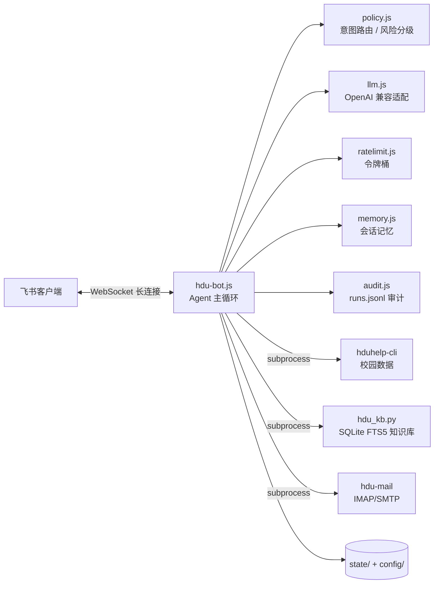

# 杭电校园助手 · HDU Campus

> 一个跑在自己电脑上的**飞书 AI 校园助手**：用自然语言查课表、成绩、班车、校园卡、图书馆座位，问校园知识库，每天早上把日程日报推成一张飞书卡片。

[](https://github.com/chenlinz0122/hdu-campus/actions/workflows/ci.yml)
[](LICENSE)


---

## 为什么做这个

学校的课表、成绩、班车、电费散在五六个系统和网页里，每次查都要点四五层。我就把它做成一个飞书机器人：**在聊天框里说一句话，它自己去查、自己组织答案、自己给出来源**。整套东西跑在本地 Windows 上，用飞书长连接接入，不需要公网 IP、不需要买服务器。

## 能做什么

| 能力 | 你可以这样说 | 实现方式 |
|---|---|---|
| 课表 / 成绩 / 考试 | 「明天有课吗」「这学期绩点多少」 | 调 HDUHelp CLI，结果结构化成卡片 |
| 阳光长跑 / 活动 / 校园卡 / 电费 | 「我长跑还差几次」「校园卡余额」 | 同上，按意图路由到对应子命令 |
| 班车 / 上课时间 / 办公电话 | 「下沙到绍兴最早一班班车几点」 | **本地知识库 RAG**，答案带原文引用 |
| 校园邮箱 | 「有没有新的教务通知邮件」 | 本地 IMAP 客户端拉取 + 摘要 |
| 每日日报 | 每天 07:00 自动推 | 飞书**交互卡片**：刷新 / 本周课表 / 关闭日报 |
| 图书馆座位、宿舍电量 | 「图书馆还有空位吗」 | 对应服务查询后返回 |

## 架构



一次请求的生命周期：飞书事件 → 白名单与限流检查 → 意图路由（闲聊 / 数据查询 / 知识库 / 邮件）→ 模型输出受限 JSON 动作 → 服务端校验后执行对应 CLI → 结果结构化 → 生成回答或卡片 → 写入审计。

## 几个我认为值得讲的设计

1. **本地 RAG 用 SQLite FTS5 而不是向量库**：资料量只有几十篇、查询是中文短句，词法检索 + 查询扩展的性价比更高，也不用额外跑 embedding 服务。检索结果必须带 `source` 引用，检索不到就**直接拒答**，不硬编答案。离线评测 12 题：`source_hit@3 = 1.0`、`recall = 1.0`、`abstention = 1.0`。
2. **模型不许直接执行动作**：LLM 只能产出受约束的 JSON 动作，服务端做白名单、参数与超时校验后才去调 CLI。模型说错话最多是答得不好，不会越权调用。
3. **安全边界在服务端**：首次对话后把 `chat_id` 写入白名单，非白名单会话不响应；令牌桶限流；每次调用都落 `runs.jsonl` 审计；飞书 App Secret、模型 Key、邮箱密码只存在 `%APPDATA%\hdu-campus`，安装时用 `icacls` 收紧权限。
4. **不需要公网 IP**：飞书长连接模式，本机主动外连即可，校园网/家用网都能跑。守护脚本在 Node 异常退出后 5 秒重启，配 VBS 隐藏窗口和开机自启。
5. **可测试**：Node 内置 test runner 写运行时单测，Python `unittest` 覆盖知识库，检索评测离线跑、不调模型——CI 里两条流水线都不需要任何密钥。

## 快速开始

### 只是自己用

1. 装 Node.js 18+、Python 3.10+（都勾 Add to PATH）
2. 下载第三方 CLI：`powershell -ExecutionPolicy Bypass -File bin\get-hduhelp.ps1`
3. 双击 `setup.cmd`，按提示填飞书 App ID / Secret、模型 Key（默认 DeepSeek）、校园邮箱（可跳过）
4. 按 [docs/INSTALL-WINDOWS.md](docs/INSTALL-WINDOWS.md) 配置飞书事件订阅与回调
5. `start-bot.vbs` 启动，`bot.cmd --digest-on 7:00` 开日报

### 开发模式

```bash
git clone https://github.com/chenlinz0122/hdu-campus.git
cd hdu-campus
npm install --prefix app
python app/kb/hdu_kb.py init
python app/kb/hdu_kb.py ingest knowledge --json
node app/bot/hdu-bot.js --check
```

配置放在 `%APPDATA%\hdu-campus\config`：`config.json`（飞书）、`llm.json`（模型）、`state.json`（会话白名单与日报状态）。字段说明见 [docs/PROTOCOL.md](docs/PROTOCOL.md)。

## 目录结构

```text
hdu-campus/
├── app/
│   ├── bot/hdu-bot.js          Agent 主循环、飞书事件、卡片、日报
│   ├── bot/lib/                audit / policy / ratelimit / memory / kb / llm
│   ├── bot/tests/              Node 单测
│   ├── kb/hdu_kb.py            本地知识库（SQLite FTS5）
│   ├── kb/tests/               Python 单测
│   └── mail/hdu-mail           校园邮箱 CLI（IMAP/SMTP，零第三方依赖）
├── knowledge/                  种子公开资料（官网抓取，带来源链接）
├── config/*.example.json       配置样例（不含任何真实凭据）
├── docs/
│   ├── INSTALL-WINDOWS.md      完整安装步骤
│   ├── ARCHITECTURE.md         分层、请求生命周期、安全控制
│   ├── PROTOCOL.md             各 CLI 与机器人协议、环境变量
│   ├── RAG.md                  知识库格式、检索与引用规则
│   └── FEISHU-SETUP.md         飞书应用配置
├── bin/                        hdu-kb.cmd / hdu-mail.cmd / get-hduhelp.ps1
├── setup.cmd · start-bot.vbs · stop-bot.cmd · bot.cmd · selftest.cmd
└── .github/workflows/ci.yml    Node + Python 两条测试流水线
```

## 测试

```bash
cd app && npm install && npm test          # Node 单测
python -m unittest discover -s app/kb/tests -v   # 知识库单测
selftest.cmd                              # 全部（含检索评测与自检）
```

## 已知限制

- 只正式支持 Windows；macOS/Linux 的运行依赖脚本还没补齐（`setenv.cmd` 是 Windows 专用）
- 检索是词法级，同义改写能力弱，问法和资料措辞差太远会漏召回
- 日报是单机定时，不支持多用户/多租户
- HDUHelp CLI 的参数契约会随版本变化，升级后要用 `schema` 子命令重新核对

## Roadmap

- [ ] 混合检索：FTS5 + 本地 embedding（bge-small）做重排，补同义召回
- [ ] 把查询链路改造成显式工作流（检索 → 生成 → 自检 → 重试的条件边），并把 KB 封装成 MCP server 供其他客户端复用
- [ ] 补 Linux/macOS 启动脚本
- [ ] 把检索评测集从小样本扩到 50+ 题，覆盖无答案拒答场景

## 免责声明

非官方项目，与杭州电子科技大学、HDUHelp 均无隶属关系。仅使用**本人账号**查询个人信息，请遵守学校与 HDUHelp 的使用条款，不要高频请求、不要批量抓取或传播他人数据。仓库内不含任何真实凭据；`bin/hduhelp-cli.exe` 为第三方二进制，不入库、需自行下载。

## License

[MIT](LICENSE) © 2026 周晨琳
